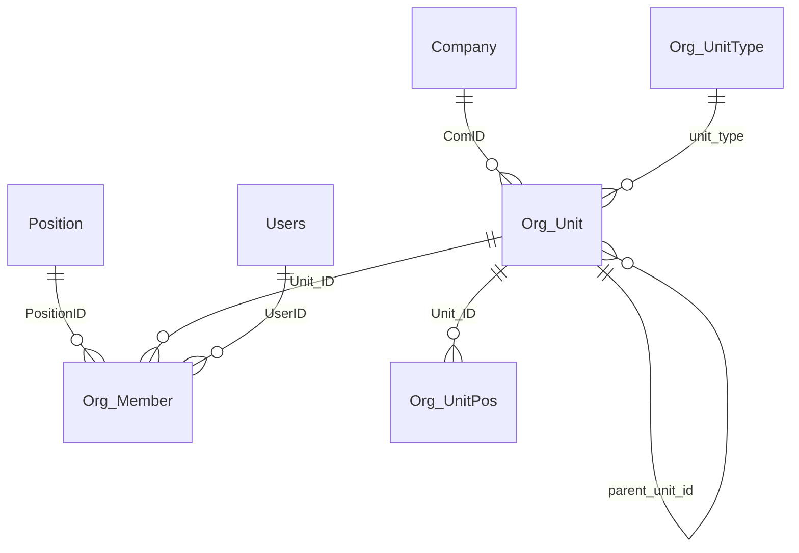

# Database Schema: PTEC_USERSRIGHT_TPD_NEW

> Generated from `10.15.100.227` / `PTEC_USERSRIGHT_TPD_NEW` on 2026-11-13 14:24. Engine: SQL Server.

## Contents

- [dbo.Company](#dbocompany) (table)
- [dbo.Department](#dbodepartment) (table)
- [dbo.Hierarchy](#dbohierarchy) (table)
- [dbo.Hierarchy_Owner](#dbohierarchy_owner) (table)
- [dbo.Org_ChangeLog](#dboorg_changelog) (table)
- [dbo.Org_Member](#dboorg_member) (table)
- [dbo.Org_Unit](#dboorg_unit) (table)
- [dbo.Org_UnitPos](#dboorg_unitpos) (table)
- [dbo.Org_UnitType](#dboorg_unittype) (table)
- [dbo.Position](#dboposition) (table)
- [dbo.Section](#dbosection) (table)
- [dbo.Users](#dbousers) (table)
- [dbo.vw_Org_Boss](#dbovw_org_boss) (view)
- [dbo.vw_Org_Unit](#dbovw_org_unit) (view)
- [dbo.vw_Org_UserPosition](#dbovw_org_userposition) (view)

## Relationships



## dbo.Company

Type: table | Rows: 6

| # | Column | Type | Null | PK | Identity | Default | Description |
|---|---|---|---|---|---|---|---|
| 1 | ComID | int | NO | PK | YES |  |  |
| 2 | ComCode | varchar(50) | NO |  |  |  |  |
| 3 | ComName | varchar(250) | NO |  |  |  |  |

**Indexes**

| Name | Type | Unique | Keys | Included | Filter |
|---|---|---|---|---|---|
| PK_Company | PK | YES | ComID |  |  |

## dbo.Department

Type: table | Rows: 59

| # | Column | Type | Null | PK | Identity | Default | Description |
|---|---|---|---|---|---|---|---|
| 1 | DepID | int | NO | PK | YES |  |  |
| 2 | BranchID | int | YES |  |  |  |  |
| 3 | DepCode | varchar(10) | YES |  |  |  |  |
| 4 | Name | varchar(50) | YES |  |  |  |  |
| 5 | Actived | bit | NO |  |  |  |  |
| 6 | FuncID | int | YES |  |  |  |  |

**Indexes**

| Name | Type | Unique | Keys | Included | Filter |
|---|---|---|---|---|---|
| PK_Department | PK | YES | DepID |  |  |

## dbo.Hierarchy

Type: table | Rows: 199

| # | Column | Type | Null | PK | Identity | Default | Description |
|---|---|---|---|---|---|---|---|
| 1 | HierarchyID | bigint | NO | PK | YES |  |  |
| 2 | DepCode | varchar(10) | YES |  |  |  |  |
| 3 | PositionID | int | NO |  |  |  |  |
| 4 | Level | int | NO |  |  |  |  |
| 5 | Actived | bit | YES |  |  |  |  |
| 6 | Affiliation | varchar(5) | NO |  |  |  |  |

**Indexes**

| Name | Type | Unique | Keys | Included | Filter |
|---|---|---|---|---|---|
| PK_Hierarchy | PK | YES | HierarchyID |  |  |

## dbo.Hierarchy_Owner

Type: table | Rows: 210

| # | Column | Type | Null | PK | Identity | Default | Description |
|---|---|---|---|---|---|---|---|
| 1 | HierarchyOwnerID | bigint | NO | PK | YES |  |  |
| 2 | OwnerID | varchar(10) | YES |  |  |  |  |
| 3 | HierarchyID | int | NO |  |  |  |  |
| 4 | Actived | bit | YES |  |  |  |  |
| 5 | SecCode | varchar(10) | YES |  |  |  |  |

**Indexes**

| Name | Type | Unique | Keys | Included | Filter |
|---|---|---|---|---|---|
| PK_Hierarchy_Owner | PK | YES | HierarchyOwnerID |  |  |

## dbo.Org_ChangeLog

Type: table | Rows: 501

| # | Column | Type | Null | PK | Identity | Default | Description |
|---|---|---|---|---|---|---|---|
| 1 | Log_ID | bigint | NO | PK | YES |  |  |
| 2 | table_name | sysname | NO |  |  |  |  |
| 3 | row_id | bigint | NO |  |  |  |  |
| 4 | action | char(1) | NO |  |  |  |  |
| 5 | old_json | nvarchar(max) | YES |  |  |  |  |
| 6 | new_json | nvarchar(max) | YES |  |  |  |  |
| 7 | ChangeBy | nvarchar(128) | NO |  |  | (suser_sname()) |  |
| 8 | ChangeDate | datetime | NO |  |  | (getdate()) |  |

**Indexes**

| Name | Type | Unique | Keys | Included | Filter |
|---|---|---|---|---|---|
| PK_Org_ChangeLog | PK | YES | Log_ID |  |  |
| IX_Org_ChangeLog_row | NONCLUSTERED |  | table_name, row_id |  |  |

## dbo.Org_Member

Type: table | Rows: 8

| # | Column | Type | Null | PK | Identity | Default | Description |
|---|---|---|---|---|---|---|---|
| 1 | Member_ID | int | NO | PK | YES |  |  |
| 2 | Unit_ID | int | NO |  |  |  |  |
| 3 | UserID | bigint | NO |  |  |  |  |
| 4 | PositionID | int | NO |  |  |  |  |
| 5 | is_manager | bit | NO |  |  | ((0)) |  |
| 6 | is_primary | bit | NO |  |  | ((0)) |  |
| 7 | start_date | date | YES |  |  |  |  |
| 8 | end_date | date | YES |  |  |  |  |
| 9 | Actived | bit | NO |  |  | ((1)) |  |
| 10 | CreateBy | varchar(50) | YES |  |  |  |  |
| 11 | CreateDate | datetime | YES |  |  | (getdate()) |  |
| 12 | UpdateBy | varchar(50) | YES |  |  |  |  |
| 13 | UpdateDate | datetime | YES |  |  |  |  |

**Foreign keys**

| Name | Columns | References | On delete | On update |
|---|---|---|---|---|
| FK_Org_Member_Position | PositionID | dbo.Position (PositionID) | NO_ACTION | NO_ACTION |
| FK_Org_Member_Unit | Unit_ID | dbo.Org_Unit (Unit_ID) | NO_ACTION | NO_ACTION |
| FK_Org_Member_User | UserID | dbo.Users (UserID) | NO_ACTION | NO_ACTION |

**Indexes**

| Name | Type | Unique | Keys | Included | Filter |
|---|---|---|---|---|---|
| PK_Org_Member | PK | YES | Member_ID |  |  |
| IX_Org_Member_unit | NONCLUSTERED |  | Unit_ID, is_manager | UserID, PositionID, start_date, end_date, Actived |  |
| IX_Org_Member_user | NONCLUSTERED |  | UserID | Unit_ID, PositionID, is_manager, is_primary, start_date, end_date, Actived |  |

**Check constraints**

- `CK_Org_Member_dates`: `([end_date] IS NULL OR [start_date] IS NULL OR [end_date]>=[start_date])`

## dbo.Org_Unit

Type: table | Rows: 5

| # | Column | Type | Null | PK | Identity | Default | Description |
|---|---|---|---|---|---|---|---|
| 1 | Unit_ID | int | NO | PK | YES |  |  |
| 2 | ComID | int | NO |  |  |  |  |
| 3 | unit_code | varchar(40) | NO |  |  |  |  |
| 4 | unit_type | varchar(10) | NO |  |  |  |  |
| 5 | unit_name | nvarchar(150) | YES |  |  |  |  |
| 6 | parent_unit_id | int | YES |  |  |  |  |
| 7 | Actived | bit | NO |  |  | ((1)) |  |
| 8 | CreateBy | varchar(50) | YES |  |  |  |  |
| 9 | CreateDate | datetime | YES |  |  | (getdate()) |  |
| 10 | UpdateBy | varchar(50) | YES |  |  |  |  |
| 11 | UpdateDate | datetime | YES |  |  |  |  |

**Foreign keys**

| Name | Columns | References | On delete | On update |
|---|---|---|---|---|
| FK_Org_Unit_Company | ComID | dbo.Company (ComID) | NO_ACTION | NO_ACTION |
| FK_Org_Unit_parent | parent_unit_id | dbo.Org_Unit (Unit_ID) | NO_ACTION | NO_ACTION |
| FK_Org_Unit_Type | unit_type | dbo.Org_UnitType (unit_type) | NO_ACTION | NO_ACTION |

**Indexes**

| Name | Type | Unique | Keys | Included | Filter |
|---|---|---|---|---|---|
| PK_Org_Unit | PK | YES | Unit_ID |  |  |
| IX_Org_Unit_parent | NONCLUSTERED |  | parent_unit_id |  |  |
| UQ_Org_Unit_code | UNIQUE constraint | YES | ComID, unit_code |  |  |

**Check constraints**

- `CK_Org_Unit_parent`: `([parent_unit_id] IS NULL OR [parent_unit_id]<>[Unit_ID])`
- `CK_Org_Unit_root`: `([unit_type]='COMPANY' AND [parent_unit_id] IS NULL OR [unit_type]<>'COMPANY')`

## dbo.Org_UnitPos

Type: table | Rows: 5

สร้างโดย `db/002_org_unit_pos.sql` — ตำแหน่ง node บนผังห้อง แยกตามคน

| # | Column | Type | Null | PK | Identity | Default | Description |
|---|---|---|---|---|---|---|---|
| 1 | UserID | bigint | NO | PK |  |  | dbo.Users.UserID · `0` = ผังกลาง (ไม่มี FK) |
| 2 | Unit_ID | int | NO | PK |  |  |  |
| 3 | pos_x | float | NO |  |  |  |  |
| 4 | pos_y | float | NO |  |  |  |  |
| 5 | UpdateDate | datetime | NO |  |  | (getdate()) |  |

**Foreign keys**

| Name | Columns | References | On delete | On update |
|---|---|---|---|---|
| FK_Org_UnitPos_Unit | Unit_ID | dbo.Org_Unit (Unit_ID) | NO_ACTION | NO_ACTION |

**Indexes**

| Name | Type | Unique | Keys | Included | Filter |
|---|---|---|---|---|---|
| PK_Org_UnitPos | PK | YES | UserID, Unit_ID |  |  |

## dbo.Org_UnitType

Type: table | Rows: 6

สร้างโดย `db/001_org_unit_types.sql` — ประเภทห้อง (ตารางกำหนดค่า) · เพิ่มประเภทใหม่ได้ด้วยการ INSERT

| # | Column | Type | Null | PK | Identity | Default | Description |
|---|---|---|---|---|---|---|---|
| 1 | unit_type | varchar(10) | NO | PK |  |  |  |
| 2 | level_no | int | YES |  |  |  | COMPANY 5 > LINE 4 > DEPT 3 > SECTION 2 > AREA 1 · NULL = TEAM (ระดับตาม rank_no ของหัวหน้าทีม) |
| 3 | name_th | nvarchar(50) | NO |  |  |  |  |
| 4 | color | varchar(7) | NO |  |  |  | สีบน node (#rrggbb) |
| 5 | sort_no | int | NO |  |  |  |  |

**Indexes**

| Name | Type | Unique | Keys | Included | Filter |
|---|---|---|---|---|---|
| PK_Org_UnitType | PK | YES | unit_type |  |  |

## dbo.Position

Type: table | Rows: 17

| # | Column | Type | Null | PK | Identity | Default | Description |
|---|---|---|---|---|---|---|---|
| 1 | PositionID | int | NO | PK | YES |  |  |
| 2 | PositionCode | varchar(50) | YES |  |  |  |  |
| 3 | Position | varchar(50) | YES |  |  |  |  |
| 4 | is_active | bit | NO |  |  |  |  |
| 5 | rank_no | int | YES |  |  |  |  |

**Indexes**

| Name | Type | Unique | Keys | Included | Filter |
|---|---|---|---|---|---|
| PK_Position | PK | YES | PositionID |  |  |

## dbo.Section

Type: table | Rows: 54

| # | Column | Type | Null | PK | Identity | Default | Description |
|---|---|---|---|---|---|---|---|
| 1 | SecID | int | NO | PK | YES |  |  |
| 2 | DepID | int | YES |  |  |  |  |
| 3 | SecCode | varchar(10) | YES |  |  |  |  |
| 4 | Name | varchar(50) | YES |  |  |  |  |
| 5 | Actived | bit | NO |  |  |  |  |

**Indexes**

| Name | Type | Unique | Keys | Included | Filter |
|---|---|---|---|---|---|
| PK_Section | PK | YES | SecID |  |  |

## dbo.Users

Type: table | Rows: 443

| # | Column | Type | Null | PK | Identity | Default | Description |
|---|---|---|---|---|---|---|---|
| 1 | UserID | bigint | NO | PK | YES |  |  |
| 2 | UserCode | varchar(10) | NO |  |  |  |  |
| 3 | Name | varchar(100) | YES |  |  |  |  |
| 4 | fristName | varchar(100) | YES |  |  |  |  |
| 5 | lastName | varchar(100) | YES |  |  |  |  |
| 6 | BranchID | int | YES |  |  |  |  |
| 7 | DepID | int | YES |  |  |  |  |
| 8 | SecID | int | YES |  |  |  |  |
| 9 | FuncID | int | YES |  |  |  |  |
| 10 | AreaID | int | YES |  |  |  |  |
| 11 | PositionID | int | YES |  |  |  |  |
| 12 | EmpUpper | bigint | YES |  |  |  |  |
| 13 | Actived | bit | YES |  |  |  |  |
| 14 | UserType | varchar(200) | YES |  |  |  |  |
| 15 | role_id | int | YES |  |  |  |  |

**Indexes**

| Name | Type | Unique | Keys | Included | Filter |
|---|---|---|---|---|---|
| PK_Users | PK | YES | UserID |  |  |
| IX_UserCode | NONCLUSTERED | YES | UserCode |  |  |

## dbo.vw_Org_Boss

Type: view

| # | Column | Type | Null | PK | Identity | Default | Description |
|---|---|---|---|---|---|---|---|
| 1 | Member_ID | int | NO |  |  |  |  |
| 2 | UserID | bigint | NO |  |  |  |  |
| 3 | UserCode | varchar(10) | NO |  |  |  |  |
| 4 | ComID | int | NO |  |  |  |  |
| 5 | unit_code | varchar(40) | NO |  |  |  |  |
| 6 | PositionCode | varchar(50) | YES |  |  |  |  |
| 7 | is_manager | bit | NO |  |  |  |  |
| 8 | is_primary | bit | NO |  |  |  |  |
| 9 | boss_user_id | bigint | YES |  |  |  |  |
| 10 | boss_code | varchar(10) | YES |  |  |  |  |
| 11 | boss_position | varchar(50) | YES |  |  |  |  |
| 12 | boss_unit | varchar(40) | YES |  |  |  |  |

**Definition**

```sql
/* vw_Org_Boss : หัวหน้าวันนี้ของทุกแถวสมาชิก (คนแรกในสายที่มีคน และไม่ใช่ตัวเอง) ใช้ sync Users.EmpUpper */
CREATE   VIEW dbo.vw_Org_Boss
AS
SELECT v.Member_ID, v.UserID, v.UserCode, v.ComID, v.unit_code, v.PositionCode, v.is_manager, v.is_primary,
       b.UserID AS boss_user_id, b.UserCode AS boss_code, b.PositionCode AS boss_position, b.unit_code AS boss_unit
FROM dbo.vw_Org_UserPosition v
OUTER APPLY (SELECT TOP 1 c.UserID, c.UserCode, c.PositionCode, c.unit_code
             FROM dbo.ufn_Org_Chain(v.Member_ID, NULL) c
             WHERE c.depth > 0 AND c.UserID IS NOT NULL AND c.UserID <> v.UserID
             ORDER BY c.depth) b;
```

## dbo.vw_Org_Unit

Type: view

| # | Column | Type | Null | PK | Identity | Default | Description |
|---|---|---|---|---|---|---|---|
| 1 | Unit_ID | int | NO |  |  |  |  |
| 2 | ComID | int | NO |  |  |  |  |
| 3 | unit_code | varchar(40) | NO |  |  |  |  |
| 4 | unit_type | varchar(10) | NO |  |  |  |  |
| 5 | unit_name | nvarchar(150) | YES |  |  |  |  |
| 6 | parent_code | varchar(40) | YES |  |  |  |  |
| 7 | manager | varchar(10) | YES |  |  |  |  |
| 8 | manager_position | varchar(50) | YES |  |  |  |  |
| 9 | members | int | YES |  |  |  |  |

**Definition**

```sql
CREATE   VIEW dbo.vw_Org_Unit
AS
/* vw_Org_Unit : ผังห้อง + หัวหน้าวันนี้ + จำนวนคน */
SELECT un.Unit_ID, un.ComID, un.unit_code, un.unit_type, un.unit_name,
       pu.unit_code AS parent_code,
       mu.UserCode AS manager, mp.PositionCode AS manager_position,
       (SELECT COUNT(*) FROM dbo.vw_Org_UserPosition v WHERE v.Unit_ID = un.Unit_ID) AS members
FROM dbo.Org_Unit un
LEFT JOIN dbo.Org_Unit pu ON pu.Unit_ID = un.parent_unit_id
OUTER APPLY dbo.ufn_Org_UnitManager(un.Unit_ID, NULL) mg
LEFT JOIN dbo.Users mu    ON mu.UserID = mg.UserID
LEFT JOIN dbo.Position mp ON mp.PositionID = mg.PositionID
WHERE un.Actived = 1;
```

## dbo.vw_Org_UserPosition

Type: view

| # | Column | Type | Null | PK | Identity | Default | Description |
|---|---|---|---|---|---|---|---|
| 1 | UserID | bigint | NO |  |  |  |  |
| 2 | UserCode | varchar(10) | NO |  |  |  |  |
| 3 | Name | varchar(100) | YES |  |  |  |  |
| 4 | ComID | int | NO |  |  |  |  |
| 5 | ComCode | varchar(50) | NO |  |  |  |  |
| 6 | Unit_ID | int | NO |  |  |  |  |
| 7 | unit_code | varchar(40) | NO |  |  |  |  |
| 8 | unit_type | varchar(10) | NO |  |  |  |  |
| 9 | unit_name | nvarchar(150) | YES |  |  |  |  |
| 10 | PositionID | int | NO |  |  |  |  |
| 11 | PositionCode | varchar(50) | YES |  |  |  |  |
| 12 | rank_no | int | YES |  |  |  |  |
| 13 | Member_ID | int | NO |  |  |  |  |
| 14 | is_manager | bit | NO |  |  |  |  |
| 15 | is_primary | bit | NO |  |  |  |  |
| 16 | start_date | date | YES |  |  |  |  |
| 17 | end_date | date | YES |  |  |  |  |

**Definition**

```sql
CREATE   VIEW dbo.vw_Org_UserPosition
AS
/* vw_Org_UserPosition : 1 แถว = 1 คน x 1 ห้องที่อยู่วันนี้ */
SELECT u.UserID, u.UserCode, u.Name,
       un.ComID, c.ComCode, un.Unit_ID, un.unit_code, un.unit_type, un.unit_name,
       p.PositionID, p.PositionCode, p.rank_no,
       m.Member_ID, m.is_manager, m.is_primary, m.start_date, m.end_date
FROM dbo.Org_Member m
JOIN dbo.Org_Unit un ON un.Unit_ID = m.Unit_ID
JOIN dbo.Company c   ON c.ComID = un.ComID
JOIN dbo.Position p  ON p.PositionID = m.PositionID
JOIN dbo.Users u     ON u.UserID = m.UserID
WHERE m.Actived = 1
  AND (m.start_date IS NULL OR m.start_date <= CAST(GETDATE() AS date))
  AND (m.end_date   IS NULL OR m.end_date   >= CAST(GETDATE() AS date));
```

## Functions, Procedures & Triggers

### dbo.ufn_Org_ApproverChain

Type: SQL_TABLE_VALUED_FUNCTION

```sql
/* ufn_Org_ApproverChain : สายของผู้ขอ @user_id สำหรับเอกสารบริษัท @com_id
   เริ่มจากห้องของผู้ขอในบริษัทนั้น (ห้องหลักก่อน · ไม่มีก็ห้องที่ไม่ใช่หัวหน้า แล้วตำแหน่งสูงสุด)
   ไม่มีห้องในบริษัทนั้น = 1 แถว note = ERROR */
CREATE   FUNCTION dbo.ufn_Org_ApproverChain (@user_id bigint, @com_id int, @as_of date)
RETURNS @t TABLE (depth int, Unit_ID int, ComID int, unit_code varchar(40), UserID bigint, UserCode varchar(10),
                  PositionCode varchar(50), rank_no int, note nvarchar(100))
AS
BEGIN
    DECLARE @start int;
    SET @as_of = ISNULL(@as_of, CAST(GETDATE() AS date));

    SELECT TOP 1 @start = m.Member_ID
    FROM dbo.Org_Member m
    JOIN dbo.Org_Unit un ON un.Unit_ID = m.Unit_ID
    JOIN dbo.Position p  ON p.PositionID = m.PositionID
    WHERE m.UserID = @user_id AND un.ComID = @com_id AND m.Actived = 1
      AND (m.start_date IS NULL OR m.start_date <= @as_of)
      AND (m.end_date   IS NULL OR m.end_date   >= @as_of)
    ORDER BY m.is_primary DESC, ISNULL(p.rank_no, 0) DESC, m.is_manager DESC, m.Member_ID;

    IF @start IS NULL
    BEGIN
        INSERT @t (depth, ComID, UserID, note) VALUES (0, @com_id, @user_id, N'ERROR: ผู้ขอไม่มีห้องในบริษัทนี้');
        RETURN;
    END

    INSERT @t SELECT * FROM dbo.ufn_Org_Chain(@start, @as_of);
    RETURN;
END
```

### dbo.ufn_Org_Chain

Type: SQL_TABLE_VALUED_FUNCTION

```sql
/* ufn_Org_Chain : สายบังคับบัญชาจากสมาชิก @member_id
   depth 0 = ตัวเอง · ถัดไป 1 แถวต่อห้องที่เดินผ่าน (ห้องไม่มีหัวหน้าก็แสดง UserID = NULL)
   ไม่ข้ามอะไร ผู้ใช้สายเลือกข้ามเอง (ห้องไม่มีหัวหน้า / คนเดิมซ้ำ) */
CREATE   FUNCTION dbo.ufn_Org_Chain (@member_id int, @as_of date)
RETURNS @t TABLE (depth int, Unit_ID int, ComID int, unit_code varchar(40), UserID bigint, UserCode varchar(10),
                  PositionCode varchar(50), rank_no int, note nvarchar(100))
AS
BEGIN
    DECLARE @unit int, @is_mgr bit, @d int = 1, @prev bigint;
    SET @as_of = ISNULL(@as_of, CAST(GETDATE() AS date));

    INSERT @t
    SELECT 0, m.Unit_ID, un.ComID, un.unit_code, m.UserID, u.UserCode, p.PositionCode, p.rank_no, NULL
    FROM dbo.Org_Member m
    JOIN dbo.Org_Unit un ON un.Unit_ID = m.Unit_ID
    JOIN dbo.Users u     ON u.UserID = m.UserID
    JOIN dbo.Position p  ON p.PositionID = m.PositionID
    WHERE m.Member_ID = @member_id;

    SELECT @unit = m.Unit_ID, @is_mgr = m.is_manager, @prev = m.UserID FROM dbo.Org_Member m WHERE m.Member_ID = @member_id;
    IF @is_mgr = 1 SELECT @unit = parent_unit_id FROM dbo.Org_Unit WHERE Unit_ID = @unit;   -- หัวหน้าห้อง -> เริ่มที่ห้องแม่

    WHILE @unit IS NOT NULL AND @d <= 30
    BEGIN
        INSERT @t
        SELECT @d, un.Unit_ID, un.ComID, un.unit_code, mg.UserID, u.UserCode, p.PositionCode, p.rank_no,
               CASE WHEN mg.UserID IS NULL THEN N'ห้องไม่มีหัวหน้า'
                    WHEN mg.UserID = @prev THEN N'คนเดิมซ้ำ' END
        FROM dbo.Org_Unit un
        OUTER APPLY dbo.ufn_Org_UnitManager(un.Unit_ID, @as_of) mg
        LEFT JOIN dbo.Users u    ON u.UserID = mg.UserID
        LEFT JOIN dbo.Position p ON p.PositionID = mg.PositionID
        WHERE un.Unit_ID = @unit;

        SELECT @prev = ISNULL((SELECT UserID FROM @t WHERE depth = @d), @prev);
        SELECT @unit = parent_unit_id FROM dbo.Org_Unit WHERE Unit_ID = @unit;
        SET @d += 1;
    END
    RETURN;
END
```

### dbo.ufn_Org_UnitHead

Type: SQL_TABLE_VALUED_FUNCTION

```sql
/* ufn_Org_UnitHead : หัวหน้าของห้อง (แทน DEPT_POSITION เช่น "DM ของ 101ITO") ถ้าว่างขึ้นไปห้องแม่จนเจอคน */
CREATE   FUNCTION dbo.ufn_Org_UnitHead (@com_id int, @unit_code varchar(40), @as_of date)
RETURNS @t TABLE (unit_code varchar(40), from_unit varchar(40), UserID bigint, UserCode varchar(10), PositionCode varchar(50), note nvarchar(100))
AS
BEGIN
    DECLARE @unit int, @d int = 0;
    SET @as_of = ISNULL(@as_of, CAST(GETDATE() AS date));
    SELECT @unit = Unit_ID FROM dbo.Org_Unit WHERE ComID = @com_id AND unit_code = @unit_code;

    WHILE @unit IS NOT NULL AND @d <= 30
    BEGIN
        IF EXISTS (SELECT 1 FROM dbo.ufn_Org_UnitManager(@unit, @as_of))
        BEGIN
            INSERT @t
            SELECT @unit_code, un.unit_code, mg.UserID, u.UserCode, p.PositionCode,
                   CASE WHEN @d > 0 THEN N'ห้องนี้ไม่มีหัวหน้า ใช้หัวหน้าห้องแม่' END
            FROM dbo.Org_Unit un
            CROSS APPLY dbo.ufn_Org_UnitManager(un.Unit_ID, @as_of) mg
            JOIN dbo.Users u    ON u.UserID = mg.UserID
            JOIN dbo.Position p ON p.PositionID = mg.PositionID
            WHERE un.Unit_ID = @unit;
            RETURN;
        END
        SELECT @unit = parent_unit_id FROM dbo.Org_Unit WHERE Unit_ID = @unit;
        SET @d += 1;
    END
    RETURN;
END
```

### dbo.ufn_Org_UnitManager

Type: SQL_INLINE_TABLE_VALUED_FUNCTION

```sql
/* =====================================================================
   FUNCTION / VIEW
   ===================================================================== */

/* หัวหน้าของห้อง ณ วันที่ (ไม่มีแถว = ห้องไม่มีหัวหน้า) */
CREATE   FUNCTION dbo.ufn_Org_UnitManager (@unit_id int, @as_of date)
RETURNS TABLE
AS
RETURN
SELECT TOP 1 m.Member_ID, m.UserID, m.PositionID
FROM dbo.Org_Member m
WHERE m.Unit_ID = @unit_id AND m.is_manager = 1 AND m.Actived = 1
  AND (m.start_date IS NULL OR m.start_date <= ISNULL(@as_of, CAST(GETDATE() AS date)))
  AND (m.end_date   IS NULL OR m.end_date   >= ISNULL(@as_of, CAST(GETDATE() AS date)))
ORDER BY m.Member_ID;
```

### dbo.usp_Org_EndUser

Type: SQL_STORED_PROCEDURE

```sql
/* ---------------------------------------------------------------------
   usp_Org_EndUser : คนลาออก
     - ทุกแถวที่ยังไม่จบ ณ @last_date -> end_date = @last_date (ไม่ลบแถว ประวัติยังอยู่)
     - แถวที่วางไว้ล่วงหน้า (เริ่มหลัง @last_date) -> Actived = 0
     - ไม่แตะ Users (Users.Actived / ปิด login ทำที่ระบบ user ตามเดิม)
     ผลลัพธ์ 1 : แถวของคนนี้หลังปิด
     ผลลัพธ์ 2 : ห้องที่คนนี้เป็นหัวหน้า -> ตั้งแต่วันถัดไปไม่มีหัวหน้า (สายจะขึ้นไปห้องแม่) ควรตั้งหัวหน้าใหม่
   --------------------------------------------------------------------- */
CREATE   PROCEDURE dbo.usp_Org_EndUser
    @user_id   bigint,
    @last_date date        = NULL,          -- NULL = วันนี้ (เริ่มไม่อยู่ตั้งแต่พรุ่งนี้)
    @by        varchar(50) = NULL
AS
BEGIN
    SET NOCOUNT ON;
    SET XACT_ABORT ON;

    DECLARE @d date = ISNULL(@last_date, CAST(GETDATE() AS date));
    DECLARE @next date = DATEADD(DAY, 1, @d);
    SET @by = ISNULL(@by, LEFT(SUSER_SNAME(), 50));

    IF NOT EXISTS (SELECT 1 FROM dbo.Org_Member
                   WHERE UserID = @user_id AND Actived = 1 AND ISNULL(end_date, '99991231') > @d)
    BEGIN RAISERROR (N'usp_Org_EndUser: คนนี้ไม่มีห้องที่ยังไม่จบหลังวันที่ระบุ', 16, 1); RETURN; END

    -- ห้องที่เป็นหัวหน้าอยู่ ณ วันถัดไป (เก็บไว้รายงาน)
    DECLARE @mgr TABLE (Unit_ID int PRIMARY KEY);
    INSERT @mgr
    SELECT DISTINCT Unit_ID FROM dbo.Org_Member
    WHERE UserID = @user_id AND Actived = 1 AND is_manager = 1
      AND ISNULL(start_date, '19000101') <= @next AND ISNULL(end_date, '99991231') >= @next;

    BEGIN TRY
        BEGIN TRANSACTION;

        UPDATE dbo.Org_Member SET Actived = 0, UpdateBy = @by, UpdateDate = GETDATE()
        WHERE UserID = @user_id AND Actived = 1 AND start_date > @d;

        UPDATE dbo.Org_Member SET end_date = @d, UpdateBy = @by, UpdateDate = GETDATE()
        WHERE UserID = @user_id AND Actived = 1 AND ISNULL(end_date, '99991231') > @d;

        COMMIT TRANSACTION;
    END TRY
    BEGIN CATCH
        IF @@TRANCOUNT > 0 ROLLBACK TRANSACTION;
        THROW;
    END CATCH

    SELECT m.Member_ID, un.ComID, un.unit_code, p.PositionCode, m.is_manager, m.is_primary,
           m.start_date, m.end_date, m.Actived
    FROM dbo.Org_Member m
    JOIN dbo.Org_Unit un ON un.Unit_ID = m.Unit_ID
    JOIN dbo.Position p  ON p.PositionID = m.PositionID
    WHERE m.UserID = @user_id AND (m.Actived = 0 OR ISNULL(m.end_date, '99991231') >= @d)
    ORDER BY m.start_date, m.Member_ID;

    SELECT un.Unit_ID, un.ComID, un.unit_code, un.unit_name,
           (SELECT COUNT(*) FROM dbo.Org_Member x
            WHERE x.Unit_ID = un.Unit_ID AND x.Actived = 1 AND x.UserID <> @user_id
              AND ISNULL(x.start_date, '19000101') <= @next AND ISNULL(x.end_date, '99991231') >= @next) AS members_left,
           (SELECT COUNT(*) FROM dbo.Org_Unit c WHERE c.parent_unit_id = un.Unit_ID AND c.Actived = 1) AS child_units,
           N'ไม่มีหัวหน้าตั้งแต่ ' + CONVERT(nvarchar(10), @next, 23) + N' ควรตั้งหัวหน้าใหม่' AS note
    FROM @mgr g JOIN dbo.Org_Unit un ON un.Unit_ID = g.Unit_ID
    ORDER BY un.ComID, un.unit_code;
END
```

### dbo.usp_Org_MoveMember

Type: SQL_STORED_PROCEDURE

```sql
/* ---------------------------------------------------------------------
   usp_Org_MoveMember
     แถวเดิมจบที่ @d-1 · แถวใหม่ในห้อง @to_unit_id เริ่ม @d ถึง end_date เดิม
     is_primary ติดไปกับแถวใหม่ (ห้องหลักไม่หลุด)
     @position_id NULL = ตำแหน่งเดิม · @is_manager = เป็นหัวหน้าห้องใหม่ไหม (ห้องใหม่มีหัวหน้าแล้ว trigger จะ error)
     ถ้าแถวเดิมเป็นหัวหน้า ห้องเดิมจะไม่มีหัวหน้าตั้งแต่ @d (แจ้งในผลลัพธ์ note)
   --------------------------------------------------------------------- */
CREATE   PROCEDURE dbo.usp_Org_MoveMember
    @member_id      int,
    @to_unit_id     int,
    @effective_date date        = NULL,     -- NULL = วันนี้
    @position_id    int         = NULL,
    @is_manager     bit         = 0,
    @by             varchar(50) = NULL
AS
BEGIN
    SET NOCOUNT ON;
    SET XACT_ABORT ON;

    DECLARE @d date = ISNULL(@effective_date, CAST(GETDATE() AS date));
    DECLARE @prev date = DATEADD(DAY, -1, @d);
    DECLARE @uid bigint, @unit int, @start date, @end date, @was_mgr bit, @act bit, @new_id int, @note nvarchar(200);
    SET @by = ISNULL(@by, LEFT(SUSER_SNAME(), 50));

    SELECT @uid = UserID, @unit = Unit_ID, @start = start_date, @end = end_date, @was_mgr = is_manager, @act = Actived,
           @position_id = ISNULL(@position_id, PositionID)
    FROM dbo.Org_Member WHERE Member_ID = @member_id;

    IF @uid IS NULL
    BEGIN RAISERROR (N'usp_Org_MoveMember: ไม่พบ Member_ID %d', 16, 1, @member_id); RETURN; END
    IF @act = 0
    BEGIN RAISERROR (N'usp_Org_MoveMember: Member_ID %d ถูกยกเลิก (Actived = 0)', 16, 1, @member_id); RETURN; END
    IF ISNULL(@start, '19000101') > @d OR ISNULL(@end, '99991231') < @d
    BEGIN RAISERROR (N'usp_Org_MoveMember: Member_ID %d ไม่ได้อยู่ห้องนี้ในวันที่มีผล', 16, 1, @member_id); RETURN; END
    IF @to_unit_id = @unit
    BEGIN RAISERROR (N'usp_Org_MoveMember: ห้องใหม่เป็นห้องเดิม', 16, 1); RETURN; END
    IF NOT EXISTS (SELECT 1 FROM dbo.Org_Unit WHERE Unit_ID = @to_unit_id AND Actived = 1)
    BEGIN RAISERROR (N'usp_Org_MoveMember: ไม่พบห้อง Unit_ID %d (หรือถูกปิด)', 16, 1, @to_unit_id); RETURN; END
    IF NOT EXISTS (SELECT 1 FROM dbo.Position WHERE PositionID = @position_id)
    BEGIN RAISERROR (N'usp_Org_MoveMember: ไม่พบ PositionID %d', 16, 1, @position_id); RETURN; END
    IF EXISTS (SELECT 1 FROM dbo.Org_Member
               WHERE UserID = @uid AND Unit_ID = @to_unit_id AND Actived = 1
                 AND ISNULL(start_date, '19000101') <= ISNULL(@end, '99991231')
                 AND ISNULL(end_date, '99991231') >= @d)
    BEGIN RAISERROR (N'usp_Org_MoveMember: คนนี้อยู่ห้องใหม่อยู่แล้วในช่วงวันที่นี้', 16, 1); RETURN; END

    BEGIN TRY
        BEGIN TRANSACTION;

        IF ISNULL(@start, '19000101') < @d
        BEGIN
            UPDATE dbo.Org_Member SET end_date = @prev, UpdateBy = @by, UpdateDate = GETDATE()
            WHERE Member_ID = @member_id;

            INSERT dbo.Org_Member (Unit_ID, UserID, PositionID, is_manager, is_primary, start_date, end_date, CreateBy)
            SELECT @to_unit_id, UserID, @position_id, @is_manager, is_primary, @d, @end, @by
            FROM dbo.Org_Member WHERE Member_ID = @member_id;
            SET @new_id = SCOPE_IDENTITY();
        END
        ELSE
        BEGIN
            UPDATE dbo.Org_Member
            SET Unit_ID = @to_unit_id, PositionID = @position_id, is_manager = @is_manager,
                UpdateBy = @by, UpdateDate = GETDATE()
            WHERE Member_ID = @member_id;
            SET @new_id = @member_id;
        END

        COMMIT TRANSACTION;
    END TRY
    BEGIN CATCH
        IF @@TRANCOUNT > 0 ROLLBACK TRANSACTION;
        THROW;
    END CATCH

    IF @was_mgr = 1 AND NOT EXISTS (SELECT 1 FROM dbo.ufn_Org_UnitManager(@unit, @d))
        SELECT @note = N'ห้องเดิม ' + unit_code + N' ไม่มีหัวหน้าตั้งแต่วันที่มีผล (จะใช้หัวหน้าห้องแม่แทน)'
        FROM dbo.Org_Unit WHERE Unit_ID = @unit;

    SELECT m.Member_ID, un.ComID, un.unit_code, p.PositionCode, m.is_manager, m.is_primary, m.start_date, m.end_date,
           CASE WHEN m.Member_ID = @new_id THEN @note END AS note
    FROM dbo.Org_Member m
    JOIN dbo.Org_Unit un ON un.Unit_ID = m.Unit_ID
    JOIN dbo.Position p  ON p.PositionID = m.PositionID
    WHERE m.UserID = @uid AND m.Actived = 1 AND ISNULL(m.end_date, '99991231') >= @prev
    ORDER BY m.start_date, m.Member_ID;
END
```

### dbo.usp_Org_SetPrimary

Type: SQL_STORED_PROCEDURE

```sql
/* ---------------------------------------------------------------------
   usp_Org_SetPrimary
     แถวเป้าหมาย T (ต้องครอบคลุม @effective_date) -> เป็นห้องหลักช่วง [@d, T.end_date]
     ห้องหลักเดิม O ทุกแถวที่ทับช่วงนั้น ถูกแบ่งเป็น
       A [O.start, @d-1]          ยังเป็นห้องหลัก   (ถ้า O เริ่มก่อน @d)
       B [max(O.start,@d), min(O.end,T.end)]  ไม่เป็นห้องหลัก (ยังเป็นสมาชิกห้องนั้น)
       C [T.end+1, O.end]         กลับมาเป็นห้องหลัก (ถ้า T มีวันจบ และ O ยาวกว่า)
     แถวเดิมของ O = ชิ้นแรก (A ถ้ามี ไม่อย่างนั้น B)
   --------------------------------------------------------------------- */
CREATE   PROCEDURE dbo.usp_Org_SetPrimary
    @member_id      int,
    @effective_date date        = NULL,     -- NULL = วันนี้
    @by             varchar(50) = NULL
AS
BEGIN
    SET NOCOUNT ON;
    SET XACT_ABORT ON;

    DECLARE @d date = ISNULL(@effective_date, CAST(GETDATE() AS date));
    DECLARE @prev date = DATEADD(DAY, -1, @d);
    DECLARE @uid bigint, @start date, @end date, @is_primary bit, @act bit;
    SET @by = ISNULL(@by, LEFT(SUSER_SNAME(), 50));

    SELECT @uid = UserID, @start = start_date, @end = end_date, @is_primary = is_primary, @act = Actived
    FROM dbo.Org_Member WHERE Member_ID = @member_id;

    IF @uid IS NULL
    BEGIN RAISERROR (N'usp_Org_SetPrimary: ไม่พบ Member_ID %d', 16, 1, @member_id); RETURN; END
    IF @act = 0
    BEGIN RAISERROR (N'usp_Org_SetPrimary: Member_ID %d ถูกยกเลิก (Actived = 0)', 16, 1, @member_id); RETURN; END
    IF ISNULL(@start, '19000101') > @d OR ISNULL(@end, '99991231') < @d
    BEGIN RAISERROR (N'usp_Org_SetPrimary: Member_ID %d ไม่ได้อยู่ห้องนี้ในวันที่มีผล', 16, 1, @member_id); RETURN; END

    IF @is_primary = 0
    BEGIN
        BEGIN TRY
            BEGIN TRANSACTION;

            /* 1) ห้องหลักเดิมที่ทับช่วง [@d, @end] */
            DECLARE @old TABLE (Member_ID int PRIMARY KEY, start_date date, end_date date,
                                has_a bit, b_end date, has_c bit);
            INSERT @old (Member_ID, start_date, end_date, has_a, b_end, has_c)
            SELECT m.Member_ID, m.start_date, m.end_date,
                   CASE WHEN ISNULL(m.start_date, '19000101') < @d THEN 1 ELSE 0 END,
                   CASE WHEN @end IS NULL THEN m.end_date
                        WHEN m.end_date IS NULL OR m.end_date > @end THEN @end
                        ELSE m.end_date END,
                   CASE WHEN @end IS NOT NULL AND ISNULL(m.end_date, '99991231') > @end THEN 1 ELSE 0 END
            FROM dbo.Org_Member m
            WHERE m.UserID = @uid AND m.Member_ID <> @member_id AND m.Actived = 1 AND m.is_primary = 1
              AND ISNULL(m.start_date, '19000101') <= ISNULL(@end, '99991231')
              AND ISNULL(m.end_date, '99991231') >= @d;

            -- แถวเดิม = ชิ้นแรก
            UPDATE m
            SET end_date   = CASE WHEN o.has_a = 1 THEN @prev ELSE o.b_end END,
                is_primary = o.has_a,
                UpdateBy = @by, UpdateDate = GETDATE()
            FROM dbo.Org_Member m JOIN @old o ON o.Member_ID = m.Member_ID;

            -- ชิ้น B (เมื่อแถวเดิมกลายเป็น A)
            INSERT dbo.Org_Member (Unit_ID, UserID, PositionID, is_manager, is_primary, start_date, end_date, CreateBy)
            SELECT m.Unit_ID, m.UserID, m.PositionID, m.is_manager, 0, @d, o.b_end, @by
            FROM dbo.Org_Member m JOIN @old o ON o.Member_ID = m.Member_ID
            WHERE o.has_a = 1;

            -- ชิ้น C
            INSERT dbo.Org_Member (Unit_ID, UserID, PositionID, is_manager, is_primary, start_date, end_date, CreateBy)
            SELECT m.Unit_ID, m.UserID, m.PositionID, m.is_manager, 1, DATEADD(DAY, 1, @end), o.end_date, @by
            FROM dbo.Org_Member m JOIN @old o ON o.Member_ID = m.Member_ID
            WHERE o.has_c = 1;

            /* 2) แถวเป้าหมาย */
            IF ISNULL(@start, '19000101') < @d
            BEGIN
                UPDATE dbo.Org_Member SET end_date = @prev, UpdateBy = @by, UpdateDate = GETDATE()
                WHERE Member_ID = @member_id;

                INSERT dbo.Org_Member (Unit_ID, UserID, PositionID, is_manager, is_primary, start_date, end_date, CreateBy)
                SELECT Unit_ID, UserID, PositionID, is_manager, 1, @d, @end, @by
                FROM dbo.Org_Member WHERE Member_ID = @member_id;
            END
            ELSE
                UPDATE dbo.Org_Member SET is_primary = 1, UpdateBy = @by, UpdateDate = GETDATE()
                WHERE Member_ID = @member_id;

            COMMIT TRANSACTION;
        END TRY
        BEGIN CATCH
            IF @@TRANCOUNT > 0 ROLLBACK TRANSACTION;
            THROW;
        END CATCH
    END

    -- ผลลัพธ์ : ทุกแถวของคนนี้ที่ยังไม่จบ ณ วันที่มีผล
    SELECT m.Member_ID, un.ComID, un.unit_code, p.PositionCode, m.is_manager, m.is_primary, m.start_date, m.end_date
    FROM dbo.Org_Member m
    JOIN dbo.Org_Unit un ON un.Unit_ID = m.Unit_ID
    JOIN dbo.Position p  ON p.PositionID = m.PositionID
    WHERE m.UserID = @uid AND m.Actived = 1 AND ISNULL(m.end_date, '99991231') >= @prev
    ORDER BY m.start_date, m.Member_ID;
END
```

### dbo.trg_Org_Member_Check

Type: SQL_TRIGGER (on Org_Member)

```sql
/* ---------------------------------------------------------------------
   trg_Org_Member_Check : กฎข้ามแถว (ช่วงวันที่ห้ามทับกัน)
     1) ห้องหนึ่ง มีหัวหน้าได้ 1 คน ณ วันใดวันหนึ่ง
     2) คนหนึ่ง มีห้องหลักได้ 1 ห้อง ณ วันใดวันหนึ่ง
     3) คนหนึ่ง อยู่ห้องเดียวกันซ้อนช่วงวันที่กันไม่ได้
   --------------------------------------------------------------------- */
CREATE   TRIGGER dbo.trg_Org_Member_Check ON dbo.Org_Member AFTER INSERT, UPDATE
AS
BEGIN
    SET NOCOUNT ON;
    DECLARE @msg nvarchar(200);

    SELECT TOP 1 @msg = CASE
             WHEN i.is_manager = 1 AND o.is_manager = 1 AND o.Unit_ID = i.Unit_ID THEN N'ห้องนี้มีหัวหน้าอยู่แล้วในช่วงวันที่เดียวกัน'
             WHEN i.is_primary = 1 AND o.is_primary = 1 AND o.UserID = i.UserID THEN N'คนนี้มีห้องหลักอยู่แล้วในช่วงวันที่เดียวกัน'
             ELSE N'คนนี้อยู่ห้องนี้ซ้อนช่วงวันที่กัน' END
    FROM inserted i
    JOIN dbo.Org_Member o ON o.Member_ID <> i.Member_ID AND o.Actived = 1
     AND ISNULL(o.start_date, '19000101') <= ISNULL(i.end_date, '99991231')
     AND ISNULL(i.start_date, '19000101') <= ISNULL(o.end_date, '99991231')
    WHERE i.Actived = 1
      AND (   (i.is_manager = 1 AND o.is_manager = 1 AND o.Unit_ID = i.Unit_ID)
           OR (i.is_primary = 1 AND o.is_primary = 1 AND o.UserID = i.UserID)
           OR (o.UserID = i.UserID AND o.Unit_ID = i.Unit_ID));

    IF @msg IS NOT NULL
    BEGIN
        RAISERROR (N'Org_Member: %s', 16, 1, @msg);
        ROLLBACK TRANSACTION;
    END
END
```

### dbo.trg_Org_Member_Log

Type: SQL_TRIGGER (on Org_Member)

```sql
CREATE   TRIGGER dbo.trg_Org_Member_Log ON dbo.Org_Member AFTER INSERT, UPDATE, DELETE
AS
BEGIN
    SET NOCOUNT ON;
    INSERT dbo.Org_ChangeLog (table_name, row_id, action, old_json, new_json)
    SELECT 'Org_Member', COALESCE(i.Member_ID, d.Member_ID),
           CASE WHEN i.Member_ID IS NOT NULL AND d.Member_ID IS NOT NULL THEN 'U' WHEN i.Member_ID IS NOT NULL THEN 'I' ELSE 'D' END,
           (SELECT x.* FROM deleted  x WHERE x.Member_ID = d.Member_ID FOR JSON PATH, WITHOUT_ARRAY_WRAPPER),
           (SELECT x.* FROM inserted x WHERE x.Member_ID = i.Member_ID FOR JSON PATH, WITHOUT_ARRAY_WRAPPER)
    FROM inserted i FULL OUTER JOIN deleted d ON d.Member_ID = i.Member_ID;
END
```

### dbo.trg_Org_Unit_Check

Type: SQL_TRIGGER (on Org_Unit)

```sql
/* trg_Org_Unit_Check : ห้องแม่ต้องอยู่บริษัทเดียวกัน และห้ามวน */
CREATE   TRIGGER dbo.trg_Org_Unit_Check ON dbo.Org_Unit AFTER INSERT, UPDATE
AS
BEGIN
    SET NOCOUNT ON;
    IF NOT UPDATE(parent_unit_id) AND NOT UPDATE(ComID) RETURN;

    IF EXISTS (SELECT 1 FROM inserted i JOIN dbo.Org_Unit p ON p.Unit_ID = i.parent_unit_id WHERE p.ComID <> i.ComID)
    BEGIN
        RAISERROR (N'Org_Unit: ห้องแม่ต้องอยู่บริษัทเดียวกัน', 16, 1);
        ROLLBACK TRANSACTION;
        RETURN;
    END

    DECLARE @loops int;
    WITH up AS (
        SELECT i.Unit_ID AS start_id, i.parent_unit_id AS cur_id, 1 AS depth FROM inserted i WHERE i.parent_unit_id IS NOT NULL
        UNION ALL
        SELECT up.start_id, u.parent_unit_id, up.depth + 1
        FROM up JOIN dbo.Org_Unit u ON u.Unit_ID = up.cur_id
        WHERE u.parent_unit_id IS NOT NULL AND up.cur_id <> up.start_id AND up.depth < 30
    )
    SELECT @loops = COUNT(*) FROM up WHERE up.cur_id = up.start_id OR up.depth >= 30
    OPTION (MAXRECURSION 40);

    IF @loops > 0
    BEGIN
        RAISERROR (N'Org_Unit: ห้องแม่วนกลับมาหาตัวเอง', 16, 1);
        ROLLBACK TRANSACTION;
    END
END
```

### dbo.trg_Org_Unit_Log

Type: SQL_TRIGGER (on Org_Unit)

```sql
CREATE   TRIGGER dbo.trg_Org_Unit_Log ON dbo.Org_Unit AFTER INSERT, UPDATE, DELETE
AS
BEGIN
    SET NOCOUNT ON;
    INSERT dbo.Org_ChangeLog (table_name, row_id, action, old_json, new_json)
    SELECT 'Org_Unit', COALESCE(i.Unit_ID, d.Unit_ID),
           CASE WHEN i.Unit_ID IS NOT NULL AND d.Unit_ID IS NOT NULL THEN 'U' WHEN i.Unit_ID IS NOT NULL THEN 'I' ELSE 'D' END,
           (SELECT x.* FROM deleted  x WHERE x.Unit_ID = d.Unit_ID FOR JSON PATH, WITHOUT_ARRAY_WRAPPER),
           (SELECT x.* FROM inserted x WHERE x.Unit_ID = i.Unit_ID FOR JSON PATH, WITHOUT_ARRAY_WRAPPER)
    FROM inserted i FULL OUTER JOIN deleted d ON d.Unit_ID = i.Unit_ID;
END
```
